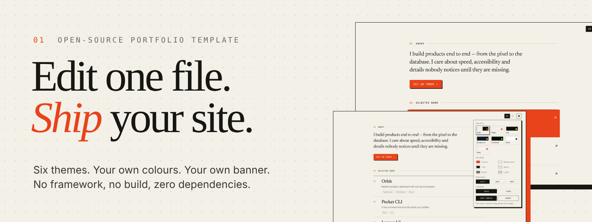
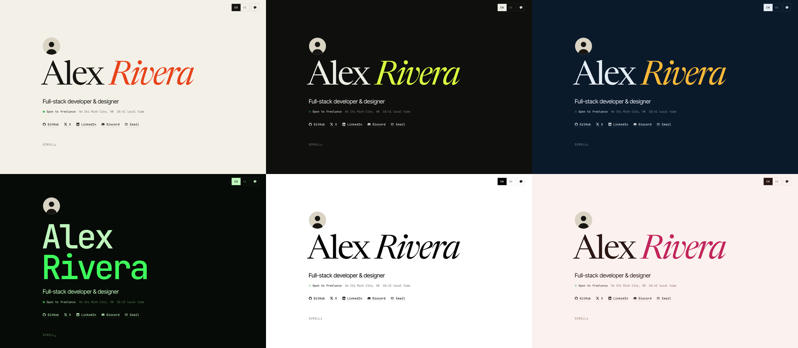
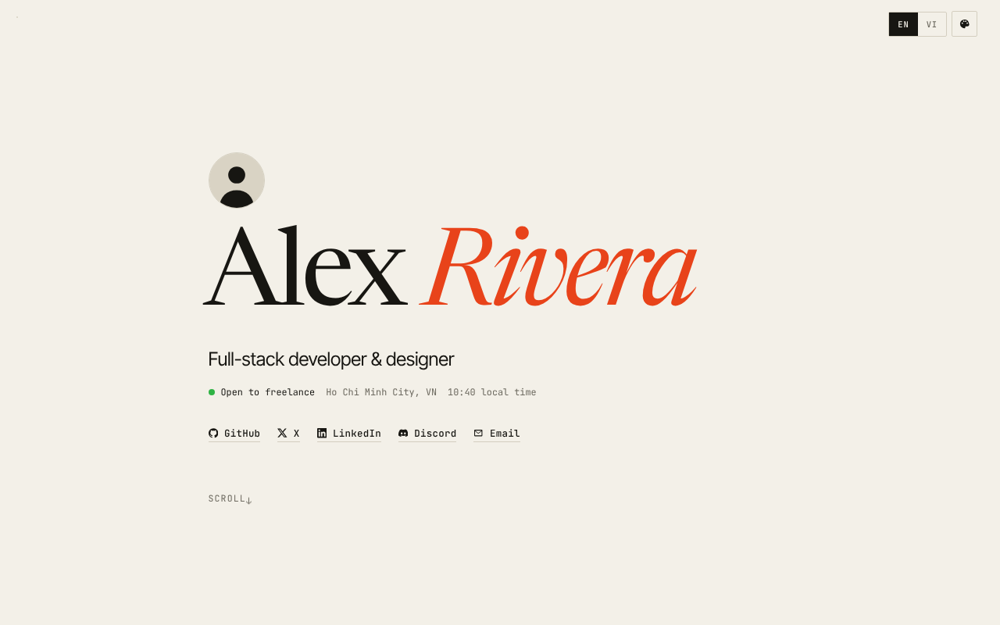
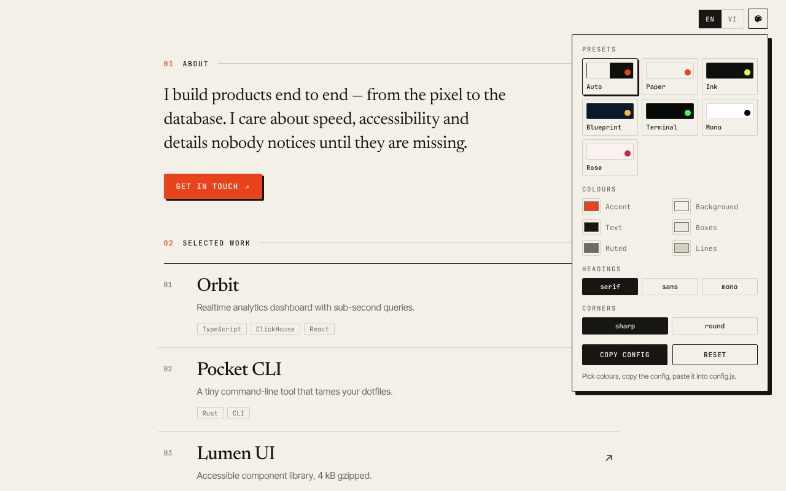

<div align="center">



<br />

**A portfolio that does not look like a template.**<br />
Editorial typography, six themes, your own colours and banner. One config file, no framework, nothing to build.

<br />

[](https://github.com/amItuff/portfolio-template/generate)
[](https://amituff.github.io/portfolio-template/)
[](https://vercel.com/new/clone?repository-url=https://github.com/amItuff/portfolio-template)
[](https://app.netlify.com/start/deploy?repository=https://github.com/amItuff/portfolio-template)

[](https://github.com/amItuff/portfolio-template/stargazers)
[](LICENSE)


[English](README.md) · [Tiếng Việt](README.vi.md)

</div>

---

## Look



<sub>Paper · Ink · Blueprint · Terminal · Mono · Rose. Or set `theme: "auto"` and it follows each visitor's light or dark mode.</sub>

## Why this one

Most portfolio templates share the same recipe: purple gradient, frosted glass, glowing buttons. This one is closer to a printed page. Big serif name, thin rules, numbered sections, a project list that fills with your accent colour on hover.

- **Make it yours in minutes.** Every setting lives in one file, [`config.js`](config.js). Save, refresh.
- **Your colours.** Pick a preset, override any colour, switch heading font (serif, sans, mono), sharp or rounded corners.
- **Theme Studio built in.** Click the palette button, try colours live, press **Copy config**, paste into `config.js`. No guessing hex codes.
- **Your banner.** Image, GIF, looping video, or a clean dotted background.
- **Two languages.** Any text can be `{ en: "…", vi: "…" }`. The switch appears by itself.
- **Optional extras.** Live Discord status, music player, local clock, copy-email button.
- **Light.** Under 30 kB of JS and CSS, no framework, no cookies, no tracking.
- **Accessible.** Keyboard friendly, visible focus, honours `prefers-reduced-motion`, good on phones.

<div align="center">


</div>

## Quick start

```bash
git clone https://github.com/amItuff/portfolio-template.git my-portfolio
cd my-portfolio
```

1. Open **`config.js`** and replace the sample values with yours. Every option has a comment.
2. Double-click `index.html` to preview, or run `npm run dev` for a local server.
3. Push to GitHub and deploy, see [Deploy](#deploy).

Or click **Use this template** at the top and edit `config.js` right in the GitHub web editor.

## Change the colours

Open the palette button on the page, tweak, then **Copy config**. It gives you something like this:

```js
appearance: {
  theme: "ink",
  colors: {
    accent: "#ff5a1f",
  },
  displayFont: "serif",
  corners: "sharp",
}
```

| Option | Values |
| --- | --- |
| `theme` | `"auto"` `"paper"` `"ink"` `"blueprint"` `"terminal"` `"mono"` `"rose"` |
| `themeLight` / `themeDark` | which two themes `"auto"` switches between |
| `colors` | any of `accent` `bg` `text` `surface` `muted` `line` as hex colours |
| `displayFont` | `"serif"` `"sans"` `"mono"` |
| `corners` | `"sharp"` `"round"` |
| `themePicker` | `false` hides the palette button |

Want a theme of your own? Copy a line in [`assets/js/themes.js`](assets/js/themes.js), give it a name, and use that name as `theme`.

### Change the banner

```js
appearance: {
  background: "assets/img/my-banner.jpg",   // image, GIF, .mp4/.webm, or a URL
  backgroundDim: 0.6,                        // 0 shows the image fully, 1 hides it
}
```

The dim layer uses your theme's background colour, so a photo stays readable in both light and dark themes. Tip: 1920×1080 or larger, under 500 kB for images, under 5 MB for video.

## Everything you can edit

| I want to change… | Edit |
| --- | --- |
| Name, tagline, bio, location, status | `profile` |
| Profile photo | `profile.avatar`, drop the file in `assets/img/` |
| Social links | `social`, 28 brand icons included |
| Projects | `projects.items` |
| Skills | `skills.items` |
| Languages | `site.languages`, one entry hides the switch |
| Intro splash | `appearance.intro: false` |
| Discord status | `discord.enabled` and your user ID |
| Music | `music.tracks`, `.mp3` files go in `assets/audio/` |
| Link preview image | `site.shareImage`, 1200×630 |

## Link previews

Social sites do not run JavaScript, so title and image must be in the HTML. After editing `config.js`:

```bash
npm run meta
```

Vercel, Netlify and the GitHub Pages workflow run it for you on every deploy.

## Deploy

| Host | How |
| --- | --- |
| **GitHub Pages** | Settings → Pages → Source: **GitHub Actions**. `.github/workflows/pages.yml` publishes on every push to `main`. |
| **Vercel** | Click the Vercel badge above. |
| **Netlify** | Click the Netlify badge above. |
| **Anything else** | Upload the folder. It is plain static files. |

Custom domain: add it in your host's dashboard, then set `site.url` in `config.js`.

## Structure

```
├── config.js              ← the file you edit
├── index.html
├── assets/
│   ├── css/style.css
│   ├── js/app.js          ← builds the page from config.js
│   ├── js/themes.js       ← colour presets
│   ├── js/icons.js        ← brand icons (Simple Icons, CC0)
│   └── img/               ← avatar, favicon, share image
└── scripts/sync-meta.js   ← copies config into <head> for link previews
```

## FAQ

<details>
<summary><b>Do I need to know how to code?</b></summary>
<br />
No. If you can edit a text file you can use this. Keep the quotes and commas in <code>config.js</code> and change the words between them.
</details>

<details>
<summary><b>Is it okay for SEO?</b></summary>
<br />
The page is built in the browser, which Google handles. Run <code>npm run meta</code> so the title, description and link previews are in the HTML as well.
</details>

<details>
<summary><b>Does it track visitors?</b></summary>
<br />
No analytics, no cookies. The only third-party requests are Google Fonts, and lanyard.rest if you turn on the Discord card.
</details>

<details>
<summary><b>Can I remove the credit in the footer?</b></summary>
<br />
Yes: <code>footer.showCredit: false</code>. A star on the repo is always welcome.
</details>

## Contributing

New themes, icons and translations are very welcome. Open an issue before bigger changes. The rule is simple: no dependencies, no build step.

## Credits

Icons by [Simple Icons](https://simpleicons.org) (CC0). Fonts: Newsreader, Inter Tight and JetBrains Mono through Google Fonts.

## License

[MIT](LICENSE). Personal, client or commercial use, all fine.

<div align="center">
<br />

If this saved you an afternoon, **[leave a star](https://github.com/amItuff/portfolio-template)** so other people can find it.

<br />

[](https://star-history.com/#amItuff/portfolio-template&Date)

</div>
