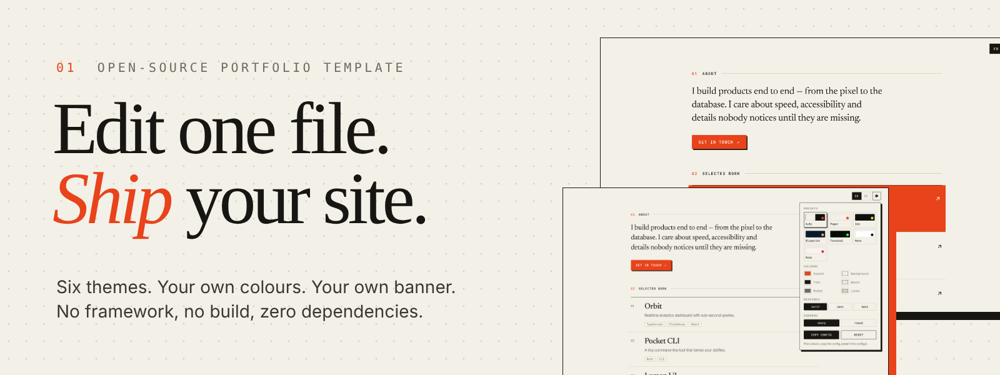
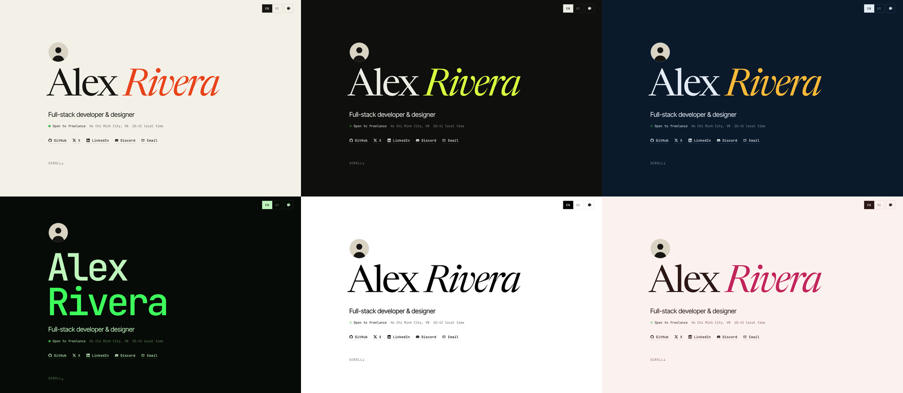
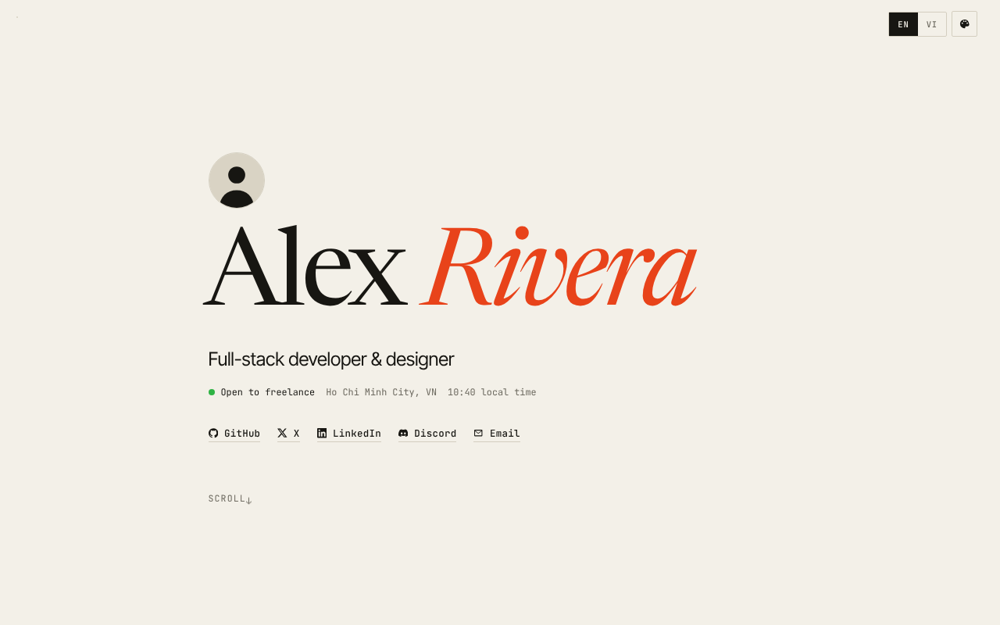
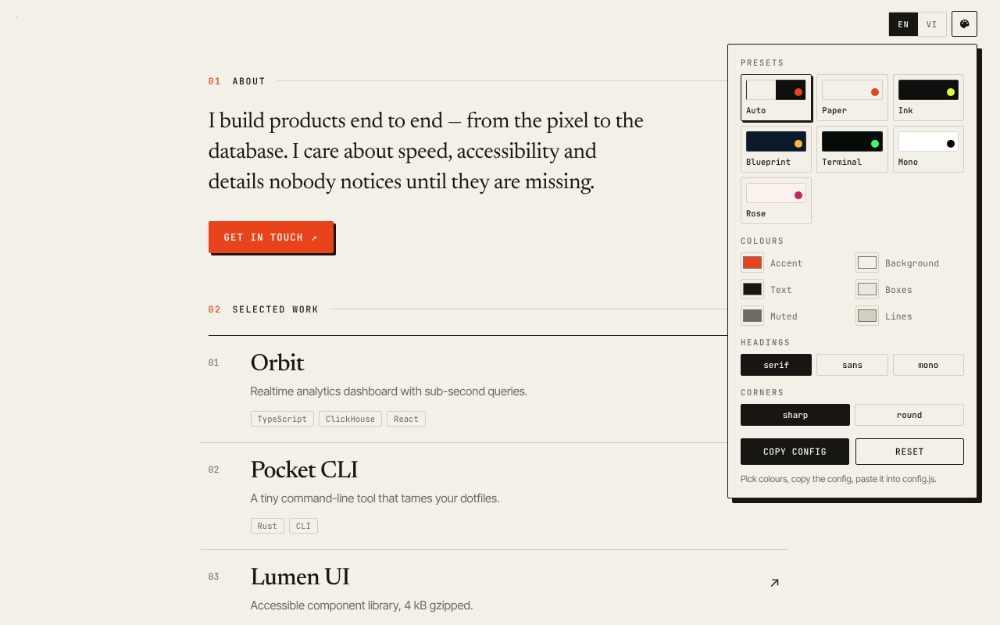

<div align="center">



<br />

**Portfolio không có cảm giác "làm từ template".**<br />
Chữ serif lớn, sáu bộ màu, tự chọn màu và banner. Chỉ một file cấu hình, không framework, không cần build.

<br />

[](https://github.com/amItuff/portfolio-template/generate)
[](https://amituff.github.io/portfolio-template/)
[](https://vercel.com/new/clone?repository-url=https://github.com/amItuff/portfolio-template)
[](https://app.netlify.com/start/deploy?repository=https://github.com/amItuff/portfolio-template)

[](https://github.com/amItuff/portfolio-template/stargazers)
[](LICENSE)


[English](README.md) · [Tiếng Việt](README.vi.md)

</div>

---

## Giao diện



<sub>Paper · Ink · Blueprint · Terminal · Mono · Rose. Hoặc đặt `theme: "auto"` để tự theo chế độ sáng/tối của người xem.</sub>

## Điểm nổi bật

- **Làm xong trong vài phút.** Mọi thứ nằm trong một file [`config.js`](config.js). Lưu rồi tải lại trang.
- **Tự chọn màu.** Chọn bộ màu có sẵn, đổi từng màu, đổi phông tiêu đề (serif, sans, mono), góc vuông hoặc bo tròn.
- **Có sẵn Theme Studio.** Bấm nút bảng màu, thử màu trực tiếp, bấm **Copy config** rồi dán vào `config.js`. Không phải đoán mã màu.
- **Banner của bạn.** Ảnh, GIF, video lặp, hoặc nền chấm bi gọn gàng.
- **Hai ngôn ngữ.** Mọi đoạn chữ viết được dạng `{ en: "…", vi: "…" }`, nút đổi ngôn ngữ tự hiện.
- **Tính năng thêm, bật khi cần.** Trạng thái Discord, trình phát nhạc, đồng hồ múi giờ, nút sao chép email.
- **Nhẹ.** Dưới 30 kB JS và CSS, không cookie, không theo dõi.

<div align="center">


</div>

## Bắt đầu nhanh

```bash
git clone https://github.com/amItuff/portfolio-template.git my-portfolio
cd my-portfolio
```

1. Mở **`config.js`**, thay giá trị mẫu bằng thông tin của bạn. Mỗi mục đều có chú thích.
2. Bấm đúp `index.html` để xem thử, hoặc chạy `npm run dev`.
3. Đẩy lên GitHub rồi deploy, xem mục [Deploy](#deploy).

Hoặc bấm **Dùng template này** ở trên rồi sửa `config.js` ngay trên web GitHub.

## Đổi màu

Bấm nút bảng màu trên trang, chỉnh xong bấm **Copy config**, ra đoạn như sau:

```js
appearance: {
  theme: "ink",
  colors: {
    accent: "#ff5a1f",
  },
  displayFont: "serif",
  corners: "sharp",
}
```

| Tùy chọn | Giá trị |
| --- | --- |
| `theme` | `"auto"` `"paper"` `"ink"` `"blueprint"` `"terminal"` `"mono"` `"rose"` |
| `themeLight` / `themeDark` | hai bộ màu mà `"auto"` chuyển qua lại |
| `colors` | `accent` `bg` `text` `surface` `muted` `line`, mã màu hex |
| `displayFont` | `"serif"` `"sans"` `"mono"` |
| `corners` | `"sharp"` `"round"` |
| `themePicker` | `false` để ẩn nút bảng màu |

Muốn bộ màu riêng: thêm một dòng trong [`assets/js/themes.js`](assets/js/themes.js), đặt tên rồi dùng tên đó cho `theme`.

### Đổi banner

```js
appearance: {
  background: "assets/img/my-banner.jpg",   // ảnh, GIF, .mp4/.webm hoặc link
  backgroundDim: 0.6,                        // 0 thấy rõ ảnh, 1 che hết
}
```

Lớp phủ dùng màu nền của bộ màu đang chọn nên ảnh luôn dễ đọc ở cả giao diện sáng và tối. Gợi ý: ảnh từ 1920×1080, dưới 500 kB; video dưới 5 MB.

## Muốn đổi gì thì sửa đâu

| Muốn đổi | Sửa |
| --- | --- |
| Tên, giới thiệu, địa điểm, trạng thái | `profile` |
| Ảnh đại diện | `profile.avatar`, bỏ file vào `assets/img/` |
| Mạng xã hội | `social`, có sẵn 28 biểu tượng |
| Dự án | `projects.items` |
| Kỹ năng | `skills.items` |
| Ngôn ngữ | `site.languages`, để một mục sẽ ẩn nút đổi |
| Màn hình chào | `appearance.intro: false` |
| Trạng thái Discord | `discord.enabled` và ID của bạn |
| Nhạc | `music.tracks`, file `.mp3` bỏ vào `assets/audio/` |
| Ảnh xem trước khi chia sẻ link | `site.shareImage`, cỡ 1200×630 |

## Xem trước khi chia sẻ link

Facebook, Discord, Zalo không chạy JavaScript nên tiêu đề và ảnh phải nằm sẵn trong HTML. Sau khi sửa `config.js`, chạy:

```bash
npm run meta
```

Vercel, Netlify và workflow GitHub Pages tự chạy lệnh này mỗi lần deploy.

## Deploy

| Nơi đăng | Cách làm |
| --- | --- |
| **GitHub Pages** | Settings → Pages → Source: **GitHub Actions**. Workflow tự đăng mỗi lần push lên `main`. |
| **Vercel** | Bấm nút Vercel ở trên. |
| **Netlify** | Bấm nút Netlify ở trên. |
| **Nơi khác** | Tải cả thư mục lên, đây chỉ là file tĩnh. |

Dùng tên miền riêng: thêm trong trang quản lý của host rồi đổi `site.url` trong `config.js`.

## Câu hỏi thường gặp

**Tôi có cần biết lập trình không?** Không. Giữ nguyên dấu nháy và dấu phẩy trong `config.js`, chỉ đổi chữ bên trong.

**Có theo dõi người truy cập không?** Không có analytics hay cookie. Chỉ có yêu cầu tới Google Fonts, và lanyard.rest nếu bật thẻ Discord.

**Xóa dòng ghi công ở chân trang được không?** Được: `footer.showCredit: false`. Một ngôi sao cho repo thì luôn được trân trọng.

## Giấy phép

[MIT](LICENSE). Dùng cá nhân, cho khách hàng hay thương mại đều được.

<div align="center">
<br />

Nếu template giúp bạn tiết kiệm một buổi chiều, hãy **[tặng repo một ngôi sao](https://github.com/amItuff/portfolio-template)**.

</div>
