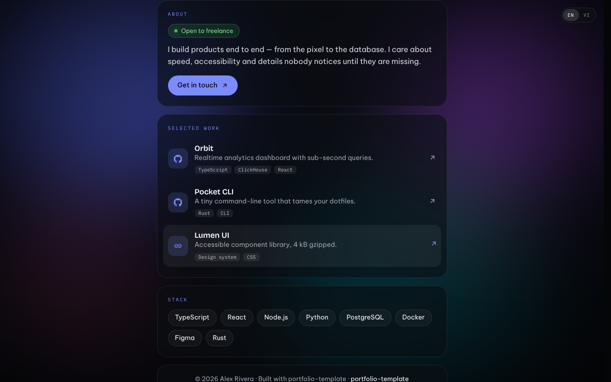

<div align="center">


<br />

**Template portfolio đẹp, nhanh, chỉ cần sửa một file.**<br />
Không framework. Không build. Không phụ thuộc thư viện. Deploy miễn phí ở bất cứ đâu.

<br />

[](https://github.com/amItuff/portfolio-template/generate)
[](https://vercel.com/new/clone?repository-url=https://github.com/amItuff/portfolio-template)
[](https://app.netlify.com/start/deploy?repository=https://github.com/amItuff/portfolio-template)

[English](README.md) · [Tiếng Việt](README.vi.md)

</div>

---

## Điểm nổi bật

- **Chỉ sửa một file.** Tên, ảnh đại diện, banner, link, dự án, màu sắc, ngôn ngữ đều nằm trong [`config.js`](config.js). Lưu rồi tải lại trang là xong.
- **Giao diện như một sản phẩm thật.** Màn hình chào có hiệu ứng, thẻ kính mờ, viền avatar phát sáng, hiệu ứng cuộn mượt.
- **Banner tùy ý.** Dùng ảnh, GIF, video lặp hoặc nền gradient động có sẵn.
- **Hai ngôn ngữ sẵn có.** Mọi đoạn chữ có thể viết dạng `{ en: "…", vi: "…" }`, nút đổi ngôn ngữ tự hiện.
- **Tính năng thêm, bật khi cần.** Trạng thái Discord trực tiếp, trình phát nhạc, đồng hồ theo múi giờ, nút sao chép email.
- **Nhanh.** Tổng JS và CSS dưới 30 kB, không theo dõi, không cookie.
- **Dễ truy cập.** Dùng được bằng bàn phím, tôn trọng `prefers-reduced-motion`, hiển thị tốt trên điện thoại.

<div align="center">


</div>

## Bắt đầu nhanh

**1. Lấy bản của bạn.** Bấm **Dùng template này** ở trên, hoặc:

```bash
git clone https://github.com/amItuff/portfolio-template.git my-portfolio
cd my-portfolio
```

**2. Sửa `config.js`.** Mở bằng trình soạn thảo bất kỳ, thay giá trị mẫu bằng thông tin của bạn. Mỗi mục đều có chú thích.

**3. Xem thử.** Bấm đúp vào `index.html`, hoặc chạy server local:

```bash
npm run dev
```

**4. Đăng lên mạng.** Đẩy code lên GitHub rồi chọn một cách ở mục [Deploy](#deploy), mất khoảng 2 phút.

## Tùy chỉnh

| Muốn đổi | Sửa |
| --- | --- |
| Tên, giới thiệu, địa điểm | `profile` |
| Ảnh đại diện | `profile.avatar`, bỏ file vào `assets/img/` |
| **Banner / ảnh nền** | `appearance.background`, nhận `.jpg` `.png` `.webp` `.gif` `.mp4` `.webm` hoặc link. `""` dùng gradient động |
| Màu chủ đạo | `appearance.accent`, ví dụ `"#ff6b6b"` |
| Độ tối của nền | `appearance.backgroundDim`, từ `0` đến `1` |
| Tắt màn hình chào | `appearance.intro: false` |
| Mạng xã hội | `social`, có sẵn 28 biểu tượng |
| Dự án | `projects.items` |
| Kỹ năng | `skills.items` |
| Trạng thái Discord | `discord.enabled` và ID Discord của bạn |
| Nhạc | `music.tracks`, bỏ file `.mp3` vào `assets/audio/` |
| Ảnh xem trước khi chia sẻ link | `site.shareImage`, cỡ 1200×630 |

### Đổi banner

```js
appearance: {
  background: "assets/img/my-banner.jpg",   // hoặc GIF, .mp4, hoặc link
  backgroundDim: 0.5,
  accent: "#ff6b6b",
}
```

Gợi ý: ảnh từ 1920×1080 trở lên, dưới 500 kB. Video nên dưới 5 MB, tắt tiếng và lặp.

## Xem trước khi chia sẻ link

Facebook, Discord, Zalo không chạy JavaScript nên cần tiêu đề và ảnh nằm sẵn trong HTML. Sau khi sửa `config.js`, chạy:

```bash
npm run meta
```

Lệnh này chép tiêu đề, mô tả, ảnh chia sẻ vào `index.html`. Vercel và Netlify tự chạy lệnh này mỗi lần deploy.

## Deploy

| Nơi đăng | Cách làm |
| --- | --- |
| **Vercel** | Bấm nút Vercel ở trên. |
| **Netlify** | Bấm nút Netlify ở trên. |
| **GitHub Pages** | Settings → Pages → Source: **GitHub Actions**. Workflow trong `.github/workflows/pages.yml` tự đăng mỗi lần push lên `main`. |
| **Nơi khác** | Tải cả thư mục lên, đây chỉ là file tĩnh. |

Dùng tên miền riêng: thêm trong trang quản lý của host rồi đổi `site.url` trong `config.js`.

## Câu hỏi thường gặp

**Tôi có cần biết lập trình không?** Không. Chỉ cần sửa được file văn bản, giữ nguyên dấu nháy và dấu phẩy trong `config.js`.

**Có theo dõi người truy cập không?** Không có analytics hay cookie. Chỉ có yêu cầu tới Google Fonts, và lanyard.rest nếu bạn bật thẻ Discord.

**Xóa dòng ghi công được không?** Được, đặt `footer.showCredit: false`. Một ngôi sao cho repo thì luôn được trân trọng.

## Giấy phép

[MIT](LICENSE). Dùng cho bản thân, cho khách hàng hay thương mại đều được.

<div align="center">
<br />

Nếu template giúp bạn tiết kiệm thời gian, hãy **[tặng repo một ngôi sao](https://github.com/amItuff/portfolio-template)** để nhiều người biết đến.

</div>
